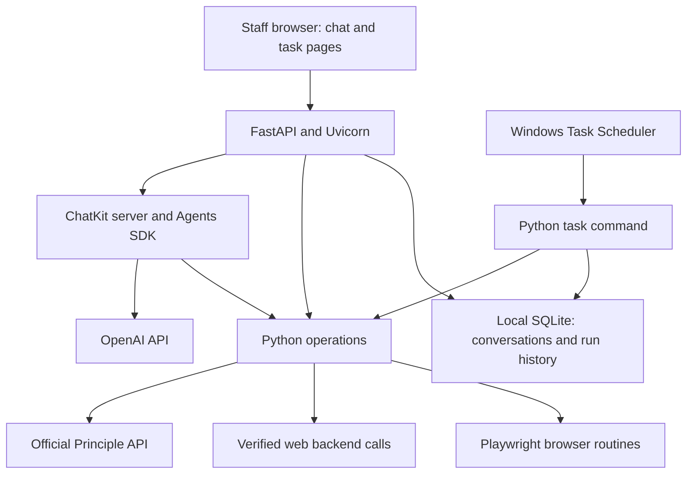

# dental_practice_admin architecture

## Purpose and constraints

A small Python application for administrative work in Principle Dental at one practice per
installation. Staff use a web browser for AI-assisted chat and ordinary task pages. Scheduled tasks
run on an always-on Windows server at the practice.

- Keep the application small enough for one person to read. Prefer established libraries and
  operating-system facilities to custom infrastructure.
- Run natively on Windows, maintainable by a small dental business.
- Read and update Principle records through the official API, verified web backend calls, or
  browser automation, chosen per operation.
- Use ordinary Python and deterministic browser automation for scheduled work. Runtime AI is a
  last resort for a step that cannot reasonably be scripted, and scheduled tasks never use it.
- A practice's own tasks live in its private repository, not here. The application supplies chat,
  execution, review, results and scheduling.

Size is judged, not capped: would a senior engineer say this is overcomplicated?
`scripts/code_size.py` counts executable application and deployment code, with tests, tooling,
comments and documentation reported separately, and CI prints the count so growth stays visible.

## Overall design

One repository holds an importable Python package, a small web application and command-line task
entry points. One long-running application process serves staff; Windows Task Scheduler launches
a separate process every five minutes to run due tasks.

FastMCP consumes the released OpenAPI snapshot in process. Microsoft's pinned Playwright MCP
server owns browser tools and script execution. Both browser modes share automatic login and one
cross-process workflow lock; API and Firestore calls remain concurrent. Model inference uses the
OpenAI API; everything else runs on the practice's server.

## Components and library choices

| Responsibility | Implementation | Reason |
| --- | --- | --- |
| Web endpoints and request validation | FastAPI and Pydantic | Small Python application with typed inputs and streaming support |
| Application server | Uvicorn, one process, standard asyncio | Native Windows operation |
| Staff chat | ChatKit web component and Python server SDK | Reuse the chat interface and streaming protocol |
| Agent execution | OpenAI Agents SDK | Reuse model and tool orchestration |
| Task and result pages | Jinja2 templates with minimal JavaScript | No separate frontend or build pipeline |
| Principle REST access | FastMCP from the released OpenAPI snapshot | No hand-maintained endpoint wrappers |
| Browser automation | Microsoft Playwright MCP with headless Chromium | Script repeatable web-only operations |
| Local persistence | SQLite with a small storage adapter | No database server to operate |
| Web service lifecycle | WinSW | Windows service management through configuration |
| Scheduling | APScheduler triggers and SQLite job store | The app owns timing; Windows launches the due-task check |
| Task review | GitPython locally; PyGithub for clean pull-request exports | Development history and audits stay on the server |
| Install and upgrade | `scripts/install_server.ps1` with Chocolatey, uv and npm | One repeatable command |

## Principle integration

The shared client binds practice scope, validates requests and responses against the released
interface, and handles paging. Patient operations check ownership before acting. Snapshot updates
are explicit and reviewed; startup never fetches a specification or package. Production reads that
see an incompatible response record a deduplicated, patient-free warning on the staff pages.

Undocumented backend access is used only after verifying authentication, data meaning and the
complete operation; a writable Firestore document does not establish that editing it directly
preserves Principle's business rules, so Firestore access is read-only. Playwright covers what is
available only through the website. After an uncertain write, never switch to another route
automatically: the first attempt may already have succeeded. `docs/principle/` records what has
been verified.

## Operations, chat and tasks

An operation is a Python function that does something useful. Chat tools validate their inputs
and call it; scheduled commands call the same function without a model. Practice scope and
permitted actions come from configuration and the signed-in user, not from model arguments.

Chat can run trusted Python and Playwright scripts under the service account. Drafts are
immutable and owner-scoped. Working source is promoted through a reviewed pull request to the
practice's private repository, with an input contract and synthetic tests. Merging is the
approval: every five minutes the launcher installs what is on the repository's default branch,
and runs use only installed files, so tasks keep running when GitHub can't be reached. See
ADR 0005.

The task page manages schedules, inputs, pause and resume. Schedules run the installed task.
APScheduler calculates triggers in the server's time zone. Due occurrences are claimed before
execution, old ones are marked missed, and interrupted runs are never replayed. Execution source,
inputs, calls and outcomes go to local JSONL audit files without credentials; SQLite indexes
results for the staff pages.

## Storage, configuration and access

SQLite and all runtime data live under `ADMIN_DATA_ROOT`, outside the installation, and Principle
remains the source of truth for practice records. Every setting is in the installation's `.env`,
and the application refuses to start with any missing. Google sign-in guards everything but
sign-in and a minimal health check. Access is open to the internet so staff can work from home,
which makes the sign-in allowlist the only access control.

## Windows deployment

`scripts/install_server.ps1` installs and upgrades everything (the README's "Installing at a
practice"). The application runs as one Uvicorn process under WinSW, and Task Scheduler runs the
due-task check every five minutes without an interactive logon, both as the non-administrator
`practice-app` account. Running as `practice-app` rather than an administrator protects the
server, not the data, and is theatre for the practice's purposes. The app holds the Principle key,
so it reaches every patient and business record Principle holds or reaches. What guards that data
is the Google sign-in allowlist and the app's code. Caddy terminates HTTPS for `ADMIN_HOST`. `scripts/verify.ps1` checks the
result; `deploy/ACCEPTANCE.md` lists what a person signs off.

## References

- [Principle Dental API reference](https://api.principle.dental/)
- [ChatKit custom-server integration](https://developers.openai.com/api/docs/guides/custom-chatkit)
- [Uvicorn event loops and Windows support](https://uvicorn.dev/concepts/event-loop/)
- [Playwright Python installation and supported systems](https://playwright.dev/python/docs/intro)
- [WinSW Windows service wrapper](https://github.com/winsw/winsw)
- [Windows Task Scheduler](https://learn.microsoft.com/en-us/windows/win32/taskschd/task-scheduler-start-page)
